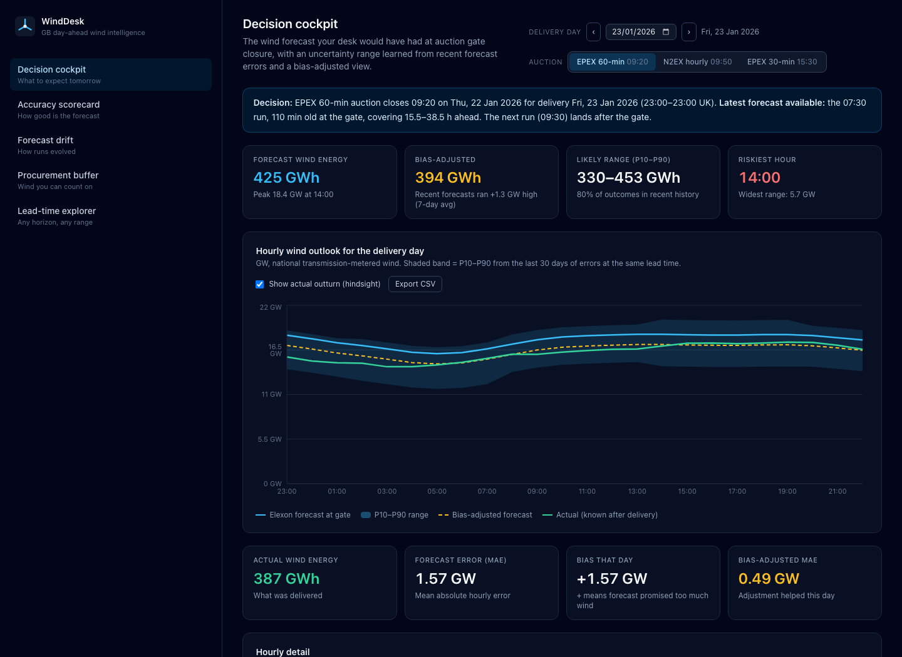
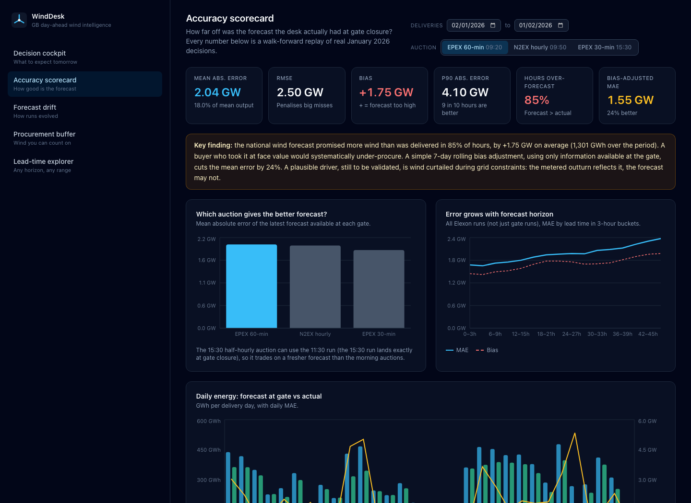
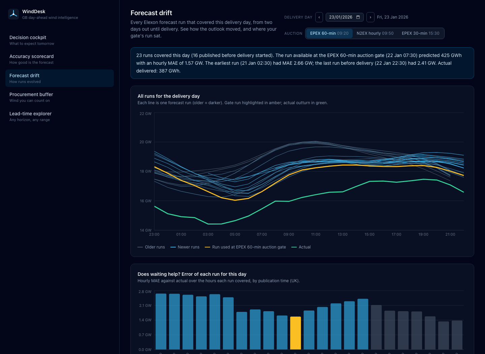
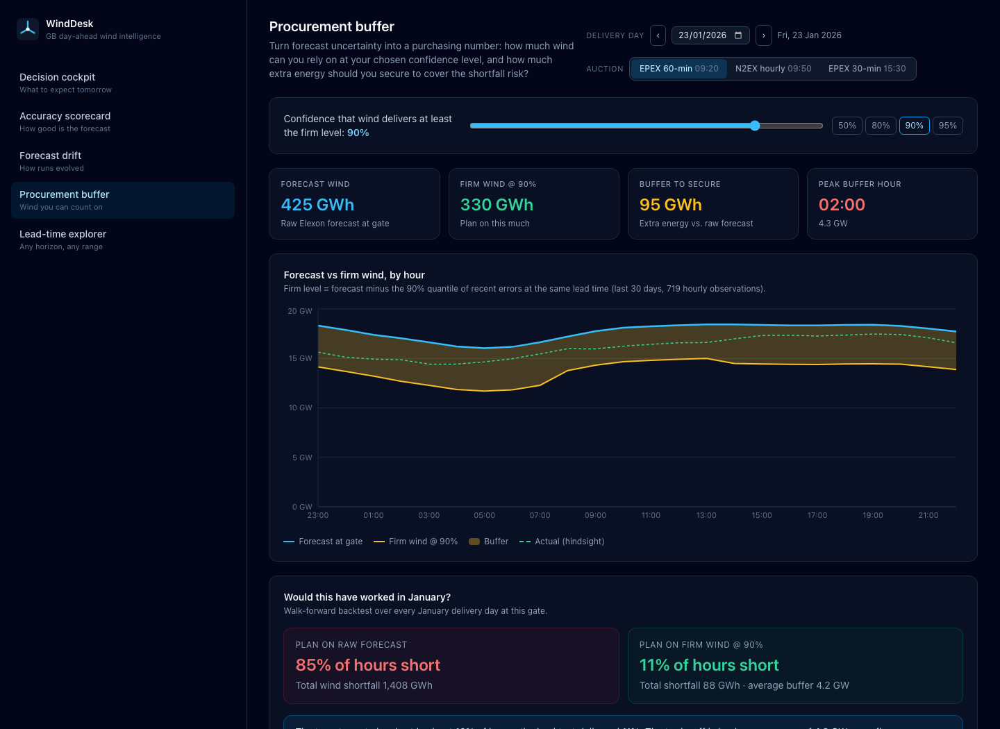
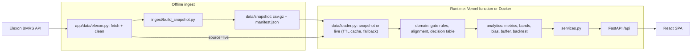

# WindDesk: day-ahead wind forecast cockpit for GB power buyers

WindDesk shows a UK utility's day-ahead trading desk **the national wind forecast it would actually have had at auction gate closure**, and **how accurate that forecast turned out to be**. Both are measured on every purchase decision made in January 2026 (the bundled snapshot). A **Live Elexon** mode applies the same analysis to a rolling 60-day window that ends tomorrow, so the desk can use it for today's decision.

- **Live app:** https://wind-forcast-nine.vercel.app
- **Video walkthrough:** _add unlisted YouTube link_
- **Page guide:** [`docs/PAGE_GUIDE.md`](docs/PAGE_GUIDE.md) explains every screen, card, chart and table in plain language, with worked examples.
- **Data:** Elexon BMRS [`FUELHH`](https://bmrs.elexon.co.uk/api-documentation/endpoint/datasets/FUELHH/stream) (actual wind, half-hourly) and [`WINDFOR`](https://bmrs.elexon.co.uk/api-documentation/endpoint/datasets/WINDFOR/stream) (wind forecasts, hourly, 8 runs a day). No other data.



## What the pilot found (January 2026 decisions)

All numbers are walk-forward replays: each delivery day only uses information that was available at its gate.

| Auction gate (UK time, D-1) | Forecast used | Mean abs. error | Bias | Bias-adjusted MAE |
|---|---|---|---|---|
| EPEX 60-min, 09:20 | 07:30 run | 2.04 GW | +1.75 GW | 1.55 GW |
| N2EX hourly, 09:50 | 09:30 run | 2.01 GW | +1.73 GW | 1.60 GW |
| EPEX 30-min, 15:30 | 11:30 run | 1.90 GW | +1.69 GW | 1.46 GW |

- **The forecast systematically promises too much wind.** It was above actual outturn in 85% of hours, by 1.75 GW on average. A desk trusting it at face value under-procures.
- **A 7-day rolling bias adjustment cuts error by about 24%**, using only errors observable before each gate.
- **The uncertainty band can be trusted:** the actual outturn fell inside the P10–P90 band in 85% of hours (target 80%) and below P10 in 11% (target 10%).
- **The procurement buffer works as designed:** planning on "firm wind at 90% confidence" left the desk short of wind in 11% of hours, against 85% when planning on the raw forecast.
- **Gate timing matters:** the 15:30 run is published exactly at the half-hourly auction's gate closure, so that auction can only use the 11:30 run. That is still about 7% more accurate than the morning auctions' forecast.

A plausible driver of the bias, still to be validated, is wind curtailed during grid constraints: metered outturn reflects it, the forecast may not.

## Features

| Screen | Question it answers | What's on it |
|---|---|---|
| **Decision cockpit** | "Tomorrow, how much wind will there be, and how sure can I be?" | Which run was available at the gate (or the latest so far, if the gate is still open), forecast energy and peak, bias-adjusted energy, likely range (P10–P90), riskiest hour, hourly chart and table. Hindsight toggle shows the actual outturn. CSV export. |
| **Accuracy scorecard** | "How good have these forecasts actually been?" | MAE, RMSE, bias, P90 error, share of hours over-forecast, bias-adjusted MAE, key finding, comparison across gates, error vs lead time (all runs), daily energy, by hour of day, error histogram, by wind level, band calibration. Any date range in the period. |
| **Forecast drift** | "Did the forecast change its mind, and would waiting have helped?" | Every run that covered a delivery day, where the gate run sat, and each run's error for that day. |
| **Procurement buffer** | "How much wind can I count on, and how much backup should I buy?" | Pick a confidence level (50–99%). Get firm wind, the buffer to secure and the peak buffer hour, with a walk-forward backtest of how often you would have been short. |
| **Lead-time explorer** | "How accurate is a forecast made exactly *N* hours ahead?" | For analysts: the latest forecast published at least *N* hours (0–48) before each target hour, compared with actuals over up to 31 days. |

**Every card, chart, table column and control has an ⓘ tooltip.** Hover, focus or tap it to see what the item means, how to read it, and a "Right now" sentence built from the numbers on screen, for example: "Across 1,396 hours (59 delivery days), the forecast available at the gate missed by 2.28 GW per hour on average." The full explanations, with worked examples, are in [`docs/PAGE_GUIDE.md`](docs/PAGE_GUIDE.md).

| Accuracy | Drift | Buffer |
|---|---|---|
|  |  |  |

## How to run

### Docker (recommended)

```bash
docker compose up --build
# app: http://localhost:8080   API docs: http://localhost:8000/api/docs
```

### Local development

```bash
# backend (Python 3.11+)
python -m venv .venv && source .venv/bin/activate
pip install -r requirements-dev.txt
cd backend && uvicorn app.main:app --reload --port 8000

# frontend (Node 22+), in another terminal; proxies /api to :8000
cd frontend && npm ci && npm run dev    # http://localhost:5173
```

### Tests and checks

```bash
cd backend && pytest -q && ruff check .
cd frontend && npm run lint && npm run build
```

### Rebuild the data snapshot from Elexon

```bash
cd backend && python -m ingest.build_snapshot
```

The snapshot is committed (about 220 KB), so the app works with no network access to Elexon.

### Data sources: snapshot or live

The sidebar switch (also `?source=snapshot|live` on every endpoint and in the page URL) picks where the data comes from:

| | Snapshot (default) | Live Elexon |
|---|---|---|
| Data | Bundled, reproducible extract | Fetched from the BMRS API on demand |
| Deliveries covered | 2 Jan to 1 Feb 2026 (January 2026 decisions) | Rolling `LIVE_DELIVERY_DAYS` (default 60) ending **tomorrow** |
| Warm-up history | December 2025 | The 32 days before the window |
| Speed | Instant, deterministic | About 5–8 s cold, then cached |

- Live uses the same cleaning code as the snapshot builder, with parallel chunked requests. The fetch end is clamped to "now", so tomorrow's cockpit shows the **latest run so far** and an amber "gate still open" banner until the auction closes.
- The result is cached in-process for `LIVE_TTL_SECONDS` (default 900). **Refresh** (`POST /api/live/refresh`) forces a re-fetch, for example to pick up a run published just before the gate.
- If a refresh fails, the last good live data is kept and flagged as stale. If Elexon was never reachable, the app falls back to the snapshot and says so.
- Every date range (date pickers, accuracy defaults, backtests, explorer bounds) comes from the served dataset's scope, so it follows whichever source is selected. Switching back to Snapshot restores the January defaults.

`DEFAULT_DATA_SOURCE=live` makes live the server-side default. The UI remembers your choice and your light/dark theme in `localStorage`. The theme defaults to the OS preference.

## Architecture



**Layering.** `domain` and `analytics` are pure functions over pandas frames, with no I/O and no web code. `services.py` composes them per use case and memoises the results on the dataset object, so a live refresh discards them automatically. Route handlers are thin: they validate input with Pydantic and FastAPI, then map `NotFoundError` to 404.

### Domain rules (in `backend/app/domain`, unit-tested)

- **Gate time** for delivery day D = the auction's UK-local gate time on D-1 (`zoneinfo`, BST-safe).
- **Latest forecast available** = the run with the greatest `publishTime` **strictly before** the gate. A run published exactly at the gate is not usable.
- **Delivery window** = 23:00 (D-1) to 23:00 (D) UK local. That is 24 hours, or 23/25 on clock-change days.
- **Lead time** = `startTime − publishTime`. Points with negative lead (each `WINDFOR` run also restates about 12 past hours) are excluded.
- **Resolution**: hourly forecasts are compared with the mean of the two half-hourly actuals in that hour (= MWh delivered). Incomplete hours are dropped.
- **Error** = forecast − actual. Positive means the forecast promised more wind than was delivered.

### No-lookahead guarantee

Bands, bias correction and the buffer for day D use only decision rows whose target hour **fully elapsed before D's gate**, from the trailing 30 days (bands, buffer) or 7 days (bias). `tests/test_analytics.py::TestNoLookahead` corrupts every future value and asserts the day's outputs do not change. Warm-up history (December 2025 for the snapshot, the 32 days before the window for live) is ingested only to feed these trailing windows and is never graded.

### Uncertainty and buffer method

Error quantiles are taken per 6-hour lead-time bucket, falling back to pooled quantiles when a bucket has fewer than 40 samples. Since actual = forecast − error, generation P10 = forecast − error P90 (and vice versa). Firm wind at confidence *c* = forecast − error quantile *c*; buffer = forecast − firm.

## Repository layout

```
api/index.py                 Vercel serverless entry; re-exports the FastAPI app
backend/
  app/
    main.py                  FastAPI app (docs at /api/docs)
    config.py                Gate presets, delivery window, snapshot and rolling live scopes, method parameters
    services.py              Use-case layer used by the routes (cached)
    api/routes.py            HTTP endpoints
    api/schemas.py           Pydantic response models
    data/elexon.py           Chunked parallel Elexon fetch with retry/backoff, cleaning, manifest
    data/loader.py           Snapshot or live dataset (TTL cache, stale/fallback), decision tables
    domain/asof.py           Gate time, delivery window, latest run, lead-time selection
    domain/align.py          Half-hour to hour alignment of actuals
    domain/decisions.py      Decision table: forecast at gate vs actual, per hour
    analytics/metrics.py     MAE, RMSE, bias, percentiles, breakdowns, histogram, lead curve
    analytics/bands.py       History-before-cutoff, lead-bucketed error quantiles, P10/P90
    analytics/bias.py        Trailing bias and correction
    analytics/buffer.py      Firm wind and buffer at a confidence level
    analytics/backtest.py    Walk-forward replay, band calibration, buffer backtest
  ingest/build_snapshot.py   Writes the snapshot + manifest using data/elexon.py
  data/snapshot/             forecasts.csv.gz, actuals.csv.gz, manifest.json (data-quality report)
  tests/                     Domain, analytics (incl. no-lookahead), API and live-source tests
  Dockerfile                 API image (non-root, healthcheck)
frontend/
  src/api/                   Typed client (TanStack Query hooks) and response types
  src/state/controls.tsx     Shared delivery-day / gate / data-source selection
  src/state/theme.ts         Light/dark theme (CSS-variable palette in index.css)
  src/components/            Layout, controls, data-source + theme toggles, cards, chart helpers
  src/components/InfoTip.tsx ⓘ tooltip popover (hover, focus, tap to pin, Escape to close)
  src/lib/glossary.ts        All tooltip text: definition, how to read it; pages add the "Right now" line
  src/pages/                 Cockpit, Accuracy, Drift, Buffer, Explorer
  Dockerfile, nginx.conf     Static build served by nginx, /api proxied to the backend
docker-compose.yml           backend + frontend
vercel.json                  Static frontend + Python function routing
.github/workflows/ci.yml     Lint, tests, frontend build, docker build
docs/PAGE_GUIDE.md           Plain-language guide to every page, with worked examples and a glossary
docs/VIDEO_SCRIPT.md         10-minute video script (client pitch + tech review)
docs/screenshots/            README screenshots
requirements.txt             Runtime Python dependencies (also used by Vercel)
requirements-dev.txt         + test and lint tools
```

## API

Interactive docs: `/api/docs`. All power values are MW (hourly means), energy is MWh, and timestamps are ISO-8601 UTC.

| Endpoint | Purpose |
|---|---|
| `GET /api/meta` | Data-source status, gates, date ranges, method parameters, data-quality manifest |
| `POST /api/live/refresh` | Re-fetch live data from Elexon now |
| `GET /api/cockpit?delivery_date&gate` | Gate run, hourly forecast, P10/P90, bias-adjusted, actual, KPIs |
| `GET /api/accuracy?gate&from&to` | Summary, corrected summary, calibration, gate comparison, breakdowns. `from`/`to` default to the whole period. |
| `GET /api/drift?delivery_date` | All runs covering the day, with per-run MAE and gate runs |
| `GET /api/buffer?delivery_date&gate&confidence` | Firm wind, buffer, walk-forward backtest over the period |
| `GET /api/explorer?from&to&horizon_h` | Forecast at least *N* h ahead vs actual |

`gate` is one of `epex_60`, `n2ex`, `epex_30`. Every GET endpoint also accepts `source=snapshot|live`.

## Assumptions and limitations

- Gate closures: EPEX 60-min 09:20, N2EX 09:50, EPEX 30-min 15:30 (UK time, D-1). Delivery day is 23:00 to 23:00 UK. Both are constants in `config.py`.
- A run counts as available from its `publishTime`. Real-world delivery latency would make the gate rule slightly stricter.
- National transmission-metered wind only (what `FUELHH` reports). Embedded wind and demand are out of scope by design.
- Bands and buffer are empirical (30 trailing days), not a probabilistic model. They adapt slowly to regime changes.
- The bias correction is deliberately simple and transparent. Lead-time- or level-dependent corrections are the obvious next step.

## Quality and security

- 57 backend tests: domain rules, analytics, no-lookahead, API contract (pinned real-data results), the live source's TTL, refresh, stale and fallback behaviour, and the rolling live window (ends tomorrow, API ranges follow the served dataset, gate-closed flag). All network-free. `ruff` lint, TypeScript strict mode.
- CI on every push: lint, tests, frontend build, Docker build.
- Dependencies scanned with Trivy (`trivy fs .`). `pytest` was pinned to 9.0.3 to fix CVE-2025-71176, and the scan is now clean.
- API container runs as a non-root user with a healthcheck.

## Deployment

Vercel serves `frontend/dist` as static files and `api/index.py` as a Python function (`vercel.json`; `"framework": null` turns off Vercel's FastAPI preset so both coexist). Deploy with `npx vercel --prod`, or connect the GitHub repo in the Vercel dashboard.

## Use of AI tools

This project was built with AI assistance (Cursor, using an AI coding agent) for research, code generation, tests and documentation. All data findings were reproduced from the Elexon data with the code in this repository and checked by automated tests.
